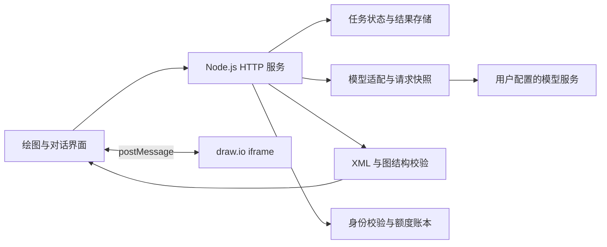

# DiagramAI

用自然语言生成、修改可编辑的 draw.io 图表，也支持独立的多模型对话。
个人 AI 应用开发项目，包含浏览器界面、Node.js 后端、任务持久化、账号权限与用量统计。

## 能做什么

- **绘图工作台**：流程图、架构图、思维导图，多页 `.drawio` 导入导出；AI 输出先校验 XML，再写入画布。
- **局部修改**：限定选中元素的修改范围，新增、删除等变更可先确认；检测手工编辑冲突，避免覆盖。
- **对话与资料**：流式回复，图片与 PDF/DOCX/文本输入；多模态 PDF 最多 50 页，仍受文件大小和模型能力限制。
- **刷新恢复**：对话与绘图任务在服务端保存状态和结果，刷新后查询原任务，不自动重发模型请求。
- **云端账号**：注册、管理员、会员等级、个人 API、平台模型、周额度、调用与缓存统计、重置卡。
- **模型配置**：OpenAI 兼容 Chat Completions、Anthropic Messages 等适配器，按模型配置能力与思考档位。

需求成图与独立 DSH 执行桥接属于实验性功能，默认关闭 DSH。开源代码包含本地开发内容，不代表所有功能已在公共实例启用。

## 本地运行

需要 Node.js 24、npm。部分 XML 交叉验证测试需要 Python 3。

```bash
npm ci
cp .env.example .env
npm start
```

打开 <http://127.0.0.1:8080/>。无需 API Key 即可选择内置示例引擎演示图表闭环；它不是大模型，无法处理任意需求。
真实生成请在「模型」中配置自己的服务地址、模型 ID 和 Key，或在 `.env` 填入 DeepSeek 配置。
纯对话位于 `/chat.html`，需要可用模型。嵌入的 draw.io 编辑器默认需要联网。

## 核心设计



- `public/`：原生 JavaScript 界面、SSE 消费、会话恢复、图表编辑器通信。
- `server.js`：本地/云端入口、静态资源、鉴权和任务接口。
- `lib/`：模型协议、图结构、持久化任务、会员与用量等模块。
- `services/dsh-bridge/`：可选的独立执行端桥接与模拟适配器，见 [实验说明](docs/experimental.md)。
- `tests/unit/`、`tests/integration/`：本地断言和模拟上游 HTTP 测试。

服务端任务用于抵抗浏览器断线，不保证进程崩溃后仍能继续上游生成；无法确认的执行应标为中断或待核对。

## 验证

```bash
npm test
```

默认测试使用隔离临时目录和本地模拟上游，不需要真实账号或模型 Key。浏览器端 E2E 脚本保存在 `tests/e2e/`，依赖额外的本机浏览器测试工具，不属于默认 CI。

## 云端部署

见 [部署说明](DEPLOYMENT.md)。本地模式仅适合可信本机访问；多用户服务请使用云端模式、HTTPS 和独立的数据目录。
云端存储使用加密文件和单实例写入，当前不是分布式数据库架构，不支持多个应用进程共享同一数据目录。

本站额度是可配置的应用点数，不等同于上游厂商余额。示例中的模型名称、会员和倍率是应用策略，必须按实际供应商调整；发布本项目不会提供任何免费模型、订阅或 API Key。
订阅连接是可选接入，依赖上游授权和账号资格，不保证任何账号可用，默认不启用云端订阅入口。

## 安全与开源范围

不包含线上账号、聊天记录、模型密钥、服务器地址、证书、备份或原始部署日志。不要提交 `.env`、`data/` 或运行日志。
安全问题请参见 [SECURITY.md](SECURITY.md)。贡献方式见 [CONTRIBUTING.md](CONTRIBUTING.md)。

项目代码采用 [MIT](LICENSE) 许可证。draw.io 通过官方 embed 页面加载，不将其完整编辑器代码作为本项目原创；滑块参考代码和 KaTeX 的来源与许可证见 [第三方说明](THIRD_PARTY_NOTICES.md)。
